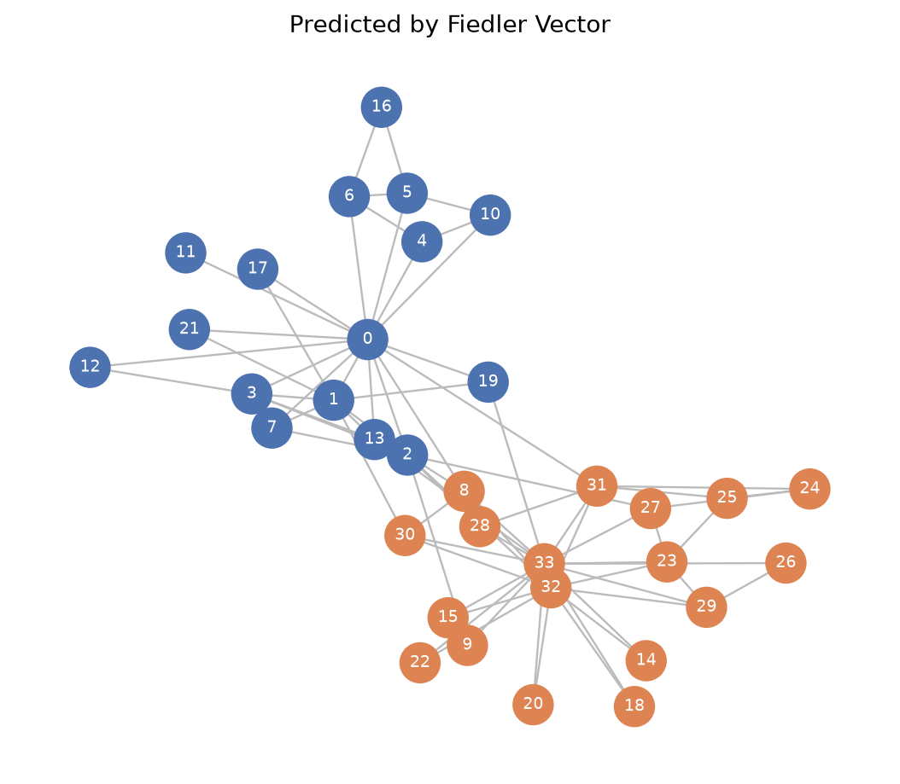

# Social Network Clustering via Eigenvalues

Community detection in social networks using the graph Laplacian, eigen-decomposition, and the **Fiedler vector** — a linear algebra mini-project applied to a real dataset (Zachary's Karate Club) with a verifiable, real-world correct answer.


## Result

> Using **only** the friendship graph — no knowledge of the actual 1970s club conflict — spectral clustering correctly predicted **33 / 34 (97.1%)** of the real-world community split.

| Method | Accuracy | ARI | NMI | Modularity |
|---|---|---|---|---|
| **Ours** — unnormalized Laplacian | **97.1%** | 0.882 | 0.837 | 0.404 |
| **Ours** — normalized Laplacian | **97.1%** | 0.882 | 0.837 | 0.404 |
| `networkx` — Newman leading-eigenvector | 97.1% | 0.882 | 0.837 | 0.404 |
| `networkx` — Louvain (merged to 2 groups) | 85.3% | 0.483 | 0.427 | 0.331 |

Our result exactly matches `networkx`'s own built-in implementation of Newman's spectral method, and modularity (Q ≈ 0.40) is consistent with the Q ≈ 0.41–0.42 reported in the literature for this exact dataset (Newman, 2006). See [`scripts/benchmark_methods.py`](scripts/benchmark_methods.py).




## What this project demonstrates

| Linear
 algebra concept | Where it's used |
|---|---|
| Matrix representation | Friendship network → adjacency matrix `A` |
| Structure of the space (rank / nullity) | `nullity(L)` = number of connected components — verified against `networkx` |
| Symmetric matrices, positive semi-definiteness | Every Laplacian built here is symmetric PSD by construction |
| Eigenvalues / eigenvectors | Full eigen-decomposition of the Laplacian |
| Diagonalization | `L = V D Vᵀ`, numerically verified (`Vᵀ V ≈ I`, reconstruction error ≈ machine precision) |
| Spectral graph theory (Fiedler's theorem) | The eigenvector of the 2nd-smallest eigenvalue optimally bisects a connected graph |
| Dimensionality reduction | k-way generalization: embed nodes in ℝᵏ using the k smallest eigenvectors, then k-means |

## Background: Zachary's Karate Club

Between 1970–1972, Wayne Zachary studied a 34-member university karate club and recorded its friendship network. A conflict between the instructor ("Mr. Hi") and the administrator ("John A") split the club in two. Because the friendship graph was recorded *before* the split, and the real outcome is known, this dataset is the standard benchmark in network-science literature for testing community-detection algorithms — it's what this project uses to check the math actually works, not just that it runs.

## Method

1. **Adjacency matrix** `A` — `A[i,j] = 1` if nodes `i, j` are connected.
2. **Laplacian** `L = D − A`, where `D = diag(degree)`. (Also provided: symmetric-normalized `L_sym = I − D^(-1/2) A D^(-1/2)`.)
3. **Eigen-decomposition** of `L` via `numpy.linalg.eigh` (the correct solver for symmetric matrices — guarantees real eigenvalues and an orthonormal eigenbasis even with repeated eigenvalues, unlike plain `eig`).
4. **Fiedler vector** — the eigenvector for the 2nd-smallest eigenvalue. By Fiedler's theorem, for a connected graph this eigenvector's sign gives the optimal 2-way partition into densely-connected communities.
5. **k-way extension** — for more than 2 clusters, embed each node using the `k` smallest eigenvectors and run k-means on the embedding (standard spectral clustering, generalizing the sign-split). The number of clusters `k` can also be chosen automatically via the **eigengap heuristic** (largest gap between consecutive sorted eigenvalues).

## Project structure

```
social-network-spectral-clustering/
├── src/spectral_clustering/
│   ├── graphs.py        # load toy graph / Zachary's Karate Club
│   ├── laplacian.py      # adjacency, degree, Laplacian(s), rank/nullity, diagonalization check
│   ├── spectral.py       # eigen-decomposition, Fiedler vector, 2-way & k-way clustering, eigengap heuristic
│   ├── metrics.py        # accuracy, modularity, ARI, NMI
│   └── visualize.py      # plotting helpers
├── scripts/
│   ├── run_toy_example.py     # walkthrough on a small 9-node graph
│   ├── run_karate_club.py     # full pipeline + figures on real data
│   └── benchmark_methods.py   # compares against networkx / Louvain baselines
├── tests/
│   └── test_spectral.py  # pytest suite: symmetry, PSD, rank-nullity, diagonalization, accuracy
├── results/               # generated figures (committed for easy viewing)
├── .github/workflows/tests.yml   # CI: runs the test suite on every push
├── requirements.txt
└── LICENSE
```

## Quick start

```bash
git clone <this-repo>
cd social-network-spectral-clustering
pip install -r requirements.txt

# run the toy example (small, fully worked-through)
python scripts/run_toy_example.py

# run the full pipeline on the real dataset
python scripts/run_karate_club.py

# compare against established baseline methods
python scripts/benchmark_methods.py

# run the test suite
pytest tests/ -v
```

## Tests

The test suite (`tests/test_spectral.py`) doesn't just check that the code runs — it checks that the *mathematics* is actually correct:

- Laplacian is symmetric and positive semi-definite
- Every row of `L` sums to zero
- `nullity(L)` equals the graph's number of connected components (verified on both a connected graph and a deliberately disconnected one)
- Diagonalization is exact to numerical precision (`Vᵀ V ≈ I`, `V D Vᵀ ≈ L`)
- The Fiedler vector correctly separates the toy graph's two known communities
- End-to-end accuracy on Zachary's Karate Club is ≥ 90% (actual: 97.1%)
- The eigengap heuristic recovers `k = 2` for a graph with an obvious 2-community structure
- Modularity of the predicted communities is meaningfully positive (not a random split)

## Extending this project

- Swap in a different network (any `networkx` graph works — try `nx.les_miserables_graph()` or your own edge list)
- Try the `k_way_spectral_clustering` function with `k > 2` on a network with more communities
- Compare `unnormalized_laplacian` vs. `normalized_laplacian_sym` on a graph with very uneven degree distribution — the normalized version tends to be more robust there
- Add weighted edges (e.g. interaction frequency instead of binary friendship) — `adjacency_matrix` already supports weighted `networkx` graphs

## References

- Fiedler, M. (1973). *Algebraic connectivity of graphs*. Czechoslovak Mathematical Journal.
- Zachary, W. W. (1977). *An information flow model for conflict and fission in small groups*. Journal of Anthropological Research.
- Newman, M. E. J. (2006). *Finding community structure in networks using the eigenvectors of matrices*. Physical Review E, 74, 036104.
- Von Luxburg, U. (2007). *A tutorial on spectral clustering*. Statistics and Computing, 17, 395–416.

## License

MIT — see [LICENSE](LICENSE).
